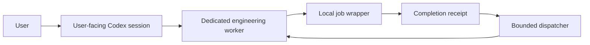

# Architecture

The runtime owns waiting, evidence, and delivery. The engineering worker owns
technical judgment. The user-facing conversation owns requirements and decisions.
Worker creation and model selection belong to the client setup.

Project profiles provide paths, named argv commands, and ceilings. They contain no
task authority. Explicit grants bind a workspace and exact worker to a scope and
finite job allowance. SQLite commits a launch reservation before a wrapper starts.

The wrapper claims a private launch token and OS file lease, runs the foreground
command, and enforces runtime/output bounds. It syncs an atomic receipt before
updating terminal state. A new controller can reconcile that receipt after an
interruption. PIDs are diagnostic; recovery never signals a stored PID or assumes
that a missing process succeeded.

Automatic continuation is a separate opt-in grant. An armed event reserves its
worker and workspace. The dispatcher verifies the receipt, idle worker, empty
queue, workspace, and permission snapshot. It commits the immutable event and
consumed attempt before starting a turn in that exact worker.

A lost acknowledgement stays uncertain. Reconciliation searches bounded history
for the saved event input and checks any acknowledged turn ID. It never resends.
Revocation blocks later reservations without pretending that an already reserved
send or active turn can be undone.

One registry is authoritative on one host. Cooperating controllers use persistent
reservations and file leases; they do not exclude a competing interactive client.
The worker must therefore be dedicated. Native child lifecycle, cross-host locks,
unattended queue progression, and live-user-session integration are outside this
release. The runtime does not create a sandbox or additional permissions.
